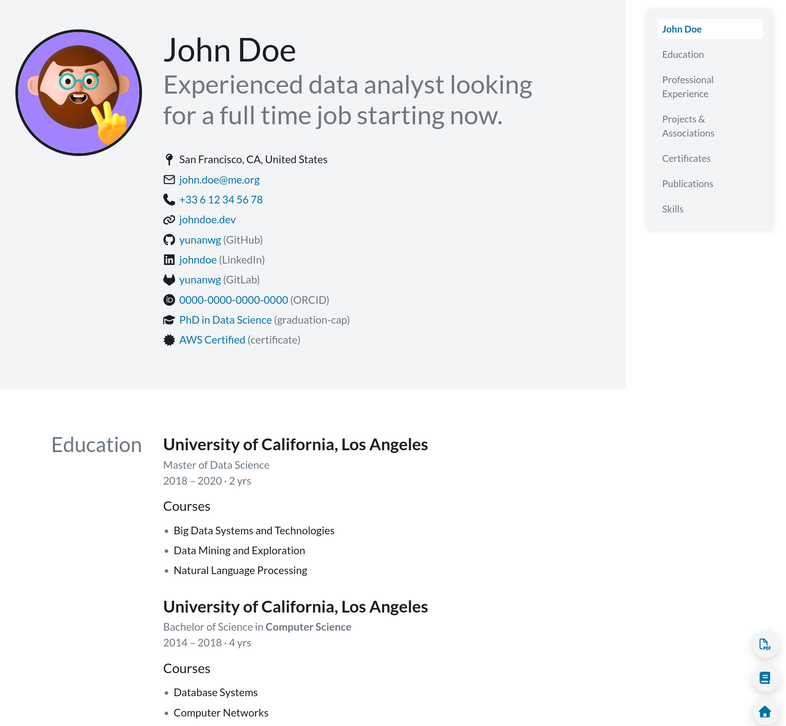
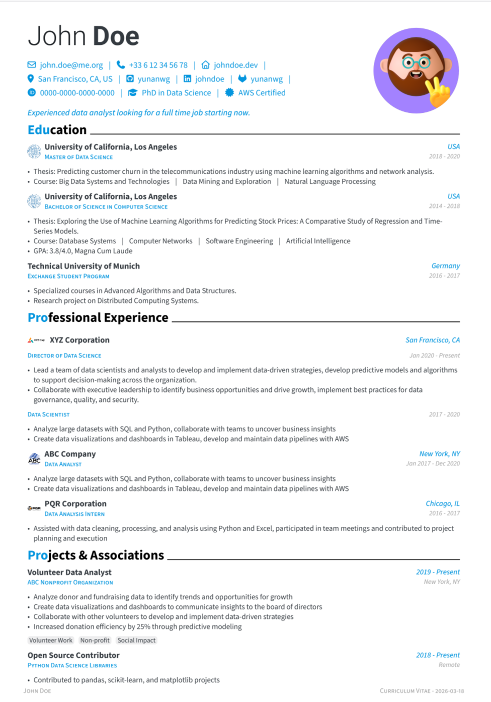

# Converted Brilliant-CV Sample

This sample is a JSON Resume conversion of the
[Brilliant-CV](https://typst.app/universe/package/brilliant-cv) English example
(the one produced when you run `typst init @preview/brilliant-cv`).

See the [live HTML sample](https://zzamboni.github.io/resume-toolkit/),
[CV PDF](https://zzamboni.github.io/resume-toolkit/john-doe-brilliantcv.pdf),
and [publications page](https://zzamboni.github.io/resume-toolkit/publications/).

Build it from the repository root:

```sh
./build-resume.sh samples/john-doe-brilliantcv/john-doe-brilliantcv.json
```

## Screenshots

HTML output:


PDF output:


